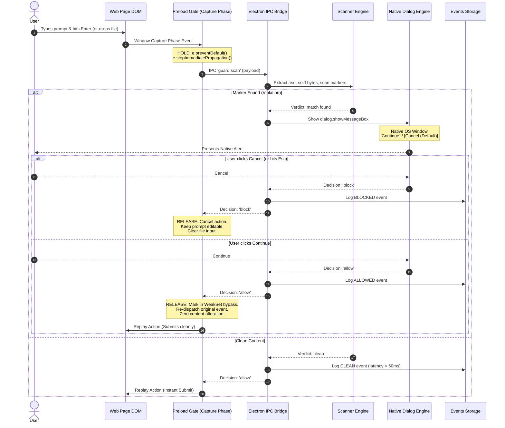
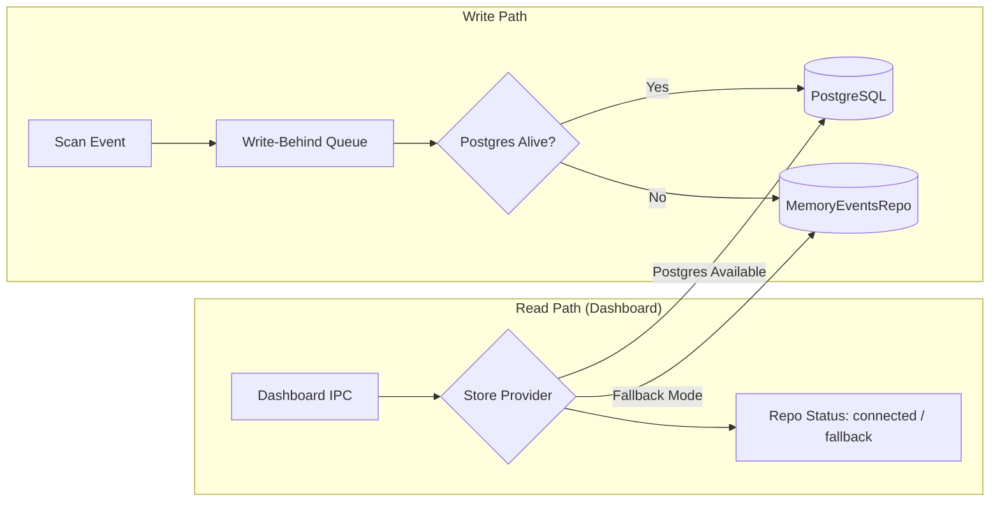

# Walled Guard: Technical Architecture & System Design

**Walled Guard** is a single-install, enterprise-grade Data Loss Prevention (DLP) desktop application built with Electron and TypeScript. It provides a real-time, zero-latency security barrier for LLM interactions on **ChatGPT** (`https://chatgpt.com`) and **Perplexity** (`https://www.perplexity.ai`), accompanied by a local PostgreSQL analytics dashboard and risk intelligence engine.

---

## 1. Architectural Philosophy

1. **Zero Browser Extension Requirement**: The application embeds verified web sessions directly in dedicated, sandboxed `WebContentsView` containers using the persistent partition `persist:walled-guard`. This eliminates the need for third-party browser extensions, proxy certificates, or background daemons.
2. **Hold, Scan, Release Paradigm**: Because DOM events are synchronous while DLP scanning and user dialogs are asynchronous, Walled Guard intercepts actions at the earliest possible capture phase, holds event propagation, scans the payload, and cleanly releases (or terminates) the action.
3. **Pure Functional Implementation**: Every component across the scanner, main process, IPC routers, and storage adapters is implemented using pure functions, factories, and closures—avoiding fragile ES6 class hierarchies.
4. **Resilient Data Storage**: A hybrid storage layer uses PostgreSQL via Drizzle ORM when available, with automatic, transparent fallback to an in-memory repository (`MemoryEventsRepo`) when PostgreSQL is offline.
5. **Fail-Closed Security**: Any unparseable file, scanner timeout, or unhandled exception fails closed, presenting a warning dialog rather than allowing uninspected data to reach remote LLM servers.

---

## 2. System Topology

```mermaid
graph TD
    subgraph "Electron Main Process"
        MainInit["Main Process Lifecycle (src/main/index.ts)"]
        TabsMgr["Tabs & View Manager (src/main/tabs.ts)"]
        GuardHandler["IPC Guard Handler (src/main/ipc/guard-handler.ts)"]
        NativeDialog["Native Dialog Engine (src/main/dialog/confirm-dialog.ts)"]
        NetGuard["Network Safety Net (src/main/network/upload-guard.ts)"]
        StyleMgr["Response Style Manager (src/main/styling/response-style.ts)"]
        Storage["Storage Layer (Drizzle ORM / MemoryEventsRepo)"]
        Analytics["Analytics & Risk Engine (src/main/analytics/)"]
    end

    subgraph "Scanner Engine (src/scanner)"
        Sniffer["Magic Byte Sniffer (sniff.ts)"]
        TextScan["Text Normalizer & Matcher"]
        PDFScan["PDF Page Extractor (pdfjs-dist)"]
        ImageScan["Jimp Preprocessor & Tesseract OCR"]
        LRU["LRU Verdict Cache & Single-Flight"]
    end

    subgraph "Embedded Web Views (persist:walled-guard)"
        Preload["Preload Script (src/preload/web.ts)"]
        Gates["DOM Gates (Prompt & File Gates)"]
        Adapters["Site Adapters (ChatGPT & Perplexity)"]
        WebDOM["Target Web Application DOM"]
    end

    subgraph "Internal Analytics UI"
        DashRenderer["Dashboard WebContentsView (HTML / Chart.js)"]
        SettingsRenderer["Settings WebContentsView"]
    end

    WebDOM --> Gates
    Gates -->|IPC: guard:scan| GuardHandler
    GuardHandler --> Sniffer
    Sniffer --> TextScan
    Sniffer --> PDFScan
    Sniffer --> ImageScan
    TextScan & PDFScan & ImageScan --> LRU
    LRU --> GuardHandler
    GuardHandler -->|If Marker Detected| NativeDialog
    NativeDialog -->|Decision: allow / block| GuardHandler
    GuardHandler -->|IPC Response| Gates
    Gates -->|Allow| WebDOM
    GuardHandler -->|Log Event| Storage
    Storage --> Analytics
    Analytics -->|IPC: analytics:get-summary| DashRenderer
    StyleMgr -->|Inject Recoloring CSS| WebDOM
    NetGuard -->|Inspect Outgoing HTTP| WebDOM
```



---

## 3. The "Hold, Scan, Release" Interception Mechanism

Standard DOM events (such as `keydown`, `click`, `change`, `drop`, and `paste`) trigger synchronously. Conversely, DLP payload extraction and native OS confirmation dialogs require asynchronous execution.

To solve this, Walled Guard implements the **Hold, Scan, Release** pattern:



### Event Handling Matrix

| Action | Interception Point | Hold Mechanism | Allow (Replay) Behavior | Block (Cancel) Behavior |
| :--- | :--- | :--- | :--- | :--- |
| **Enter Keystroke** | `window.addEventListener('keydown', ..., true)` | `e.preventDefault()`, `e.stopImmediatePropagation()` | Synthetically triggers verified Send Button click with `WeakSet` bypass | No-op: prompt text remains fully editable in editor |
| **Send Button Click** | `window.addEventListener('click', ..., true)` | `e.preventDefault()`, `e.stopImmediatePropagation()` | Re-clicks Send Button with `WeakSet` bypass flag | No-op: user retains focus and prompt |
| **File Picker Change** | `input[type="file"]` change listener | `e.stopImmediatePropagation()` | Re-dispatches `change` event with one-shot bypass | Resets `input.value = ''` to prevent transmission |
| **Drag and Drop** | `window.addEventListener('drop', ..., true)` | `e.preventDefault()`, `e.stopImmediatePropagation()` | Dispatches synthetic `drop` event with cached `DataTransfer` | Discards dropped items silently |
| **Clipboard Paste** | `window.addEventListener('paste', ..., true)` | `e.preventDefault()`, `e.stopImmediatePropagation()` | Dispatches synthetic `paste` event with clipboard data | Discards paste operation |

---

## 4. Multimodal Scanner Engine

The scanner engine (`src/scanner`) operates as a completely decoupled, pure TypeScript module.

### A. Magic Byte Sniffing (`sniff.ts`)
To prevent attackers from bypassing file restrictions by changing file extensions (e.g. renaming `.exe` or `.pdf` to `.txt`), the sniffer checks binary magic headers:
- **PDF**: `%PDF-` (`0x25 0x50 0x44 0x46 0x2D`)
- **PNG**: `0x89 0x50 0x4E 0x47 0x0D 0x0A 0x1A 0x0A`
- **JPEG**: `0xFF 0xD8 0xFF`
- **WebP**: `RIFF....WEBP`
- **GIF**: `GIF87a` / `GIF89a`
- Fallback: Validates valid UTF-8 encoding before treating as plain text.

### B. Text Normalization & Streaming Matcher
1. **NFKC Normalization**: Converts lookalike Unicode glyphs and compatibility characters to standard forms.
2. **Zero-Width Stripping**: Removes zero-width spaces (`\u200B`), soft hyphens (`\u00AD`), zero-width joiners (`\u200D`), and byte order marks (`\uFEFF`).
3. **Windowed Chunk Scanning**: Scans large text buffers in 64 KB sliding windows with marker-length overlaps to prevent split-boundary bypasses.
4. **UTF-16 Byte Scanning**: Inspects raw binary streams for both Little-Endian and Big-Endian encoded strings without requiring full decoding.

### C. PDF Text Extractor (`extractors/pdf.ts`)
- Powered by `pdfjs-dist/legacy/build/pdf.mjs`.
- Inspects documents page by page.
- **Early Exit Optimization**: As soon as any sensitive marker is discovered on page $k$, extraction terminates immediately without parsing the remaining pages.

### D. Image OCR Pipeline (`extractors/image.ts`)
- **Jimp Preprocessing**:
  1. Downscales excessively large images (max dimension 2,000 px).
  2. Converts image to single-channel 8-bit grayscale for enhanced contrast.
  3. Supports inverted polarity pass for white-on-black dark-mode screenshots.
- **Tesseract.js Engine**:
  - Bundled with local offline language data (`resources/tessdata/eng.traineddata`).
  - Zero outbound network requests during OCR execution.
- **Fuzzy OCR Matcher**:
  - Strips non-alphanumeric noise caused by OCR misreads (e.g. `WALLED_SENSITIVE` read as `WALLED-SENS1TIVE`).
  - Employs Levenshtein distance $\le 1$ sliding window for high-confidence identification.

### E. Caching & Single-Flight
- **Verdict Cache**: LRU cache (1,000 entries, 5-minute TTL) keyed by SHA-256 hash of payload bytes.
- **Single-Flight Coalescing**: Duplicate concurrent scans of the same file share a single in-flight Promise.
- **Important**: Only scan *verdicts* are cached. The user *decision* (Continue vs Cancel) is **never** cached—ensuring that every subsequent attempt to send sensitive data correctly re-prompts the user.

---

## 5. Storage Layer & Failover Strategy



### PostgreSQL Schema (Drizzle ORM)
The database defines an `events` table with:
- `id` (UUID primary key)
- `timestamp` (ISO timestamp with index)
- `channel` (`prompt` | `file`)
- `site` (`chatgpt` | `perplexity`)
- `verdict` (`clean` | `flagged`)
- `action` (`allowed` | `blocked`)
- `marker_detected` (Text marker or null)
- `file_type` (e.g. `application/pdf`, `image/png`, `text/plain`)
- `file_size_bytes` (Integer)
- `latency_ms` (Integer execution time)

### In-Memory Fallback (`MemoryEventsRepo`)
To ensure zero evaluator friction (e.g. if Docker or local Postgres is not started), Walled Guard initializes a probe on startup. If PostgreSQL connection fails:
- The system automatically activates `MemoryEventsRepo`.
- All events are stored in a rolling in-memory buffer (retaining the latest 10,000 events).
- The dashboard displays an informative "Storage: In-Memory Fallback" banner.
- All DLP scanning, native dialogs, and analytics charts operate with 100% functionality.

---

## 6. Response Recoloring Engine (`#00A86B`)

The response styling engine (`src/main/styling/response-style.ts`) recolors AI assistant text across both ChatGPT and Perplexity to **Spring Green** (`#00A86B`):

1. **Selector Targeting**:
   - ChatGPT: `[data-message-author-role="assistant"]`, `.agent-turn`
   - Perplexity: `[data-testid="answer-content"]`, `.prose`
2. **Selective Isolation**:
   To prevent corrupting readable content, code elements, hyperlinks, and markdown structures are explicitly protected using `revert !important`:
   ```css
   /* Preserved Elements */
   pre, code, pre *, code *,
   a, a *, table, table *,
   button, [role="button"] {
     color: revert !important;
   }
   ```
3. **Dynamic Stream Handling**:
   A lightweight `MutationObserver` in the preload script attaches styling as streaming tokens arrive in the DOM, guaranteeing zero flicker for live generation or historical conversations.

---

## 7. Fail-Closed Security & Hardening

1. **State C Fail-Closed Dialog**: If a file is malformed, corrupted, or exceeds system scan limits (50 MB), the scanner emits a `ScanVerdict` with `error` status. Walled Guard treats this as suspicious and presents the State C dialog:
   *"Scan could not complete. Proceed with caution."*
2. **Network Safety Net**: An out-of-band network listener (`session.webRequest.onBeforeRequest`) inspects HTTP requests to known upload endpoints (`chatgpt.com/backend-api`, `perplexity.ai/api`). If an upload arrives without a matching pre-approved DOM token in the 60-second approval cache, the request is canceled (`cancel: true`).
3. **Origin Lockdown**: Navigation events (`will-navigate` and `setWindowOpenHandler`) restrict the embedded browser views to approved authentication and application domains (`chatgpt.com`, `perplexity.ai`, `auth.openai.com`, `google.com`, `appleid.apple.com`). All external web links automatically open in the user's default desktop browser via `shell.openExternal`.

---

## 8. Enterprise Extensibility & Future Roadmap

Because the core scanner (`src/scanner`) contains **zero Electron or Node GUI dependencies**, the architecture enables straightforward reuse in enterprise infrastructure:

1. **Browser Extension Packaging**: `src/scanner` can be compiled into a WebAssembly / Service Worker bundle for deployment across Chrome, Edge, and Safari enterprise fleets via MDM/GPO.
2. **Proxy / CASB Gateway**: The same scanner functions can be mounted inside a forward proxy (e.g. Envoy or Cloudflare Workers) for corporate network egress filtering.
3. **Dynamic Policy Service**: The hardcoded test marker (`WALLED_SENSITIVE`) can be swapped for dynamic regex patterns (SSN, credit cards, AWS keys) fetched from a central SIEM or enterprise security orchestrator.
